 

### Stack

 

### Building

 

### Activity

 

  

<picture>
  <source media="(prefers-color-scheme: dark)" srcset="https://raw.githubusercontent.com/adhnanjeff/adhnanjeff/output/github-contribution-grid-snake-dark.svg" />
  <source media="(prefers-color-scheme: light)" srcset="https://raw.githubusercontent.com/adhnanjeff/adhnanjeff/output/github-contribution-grid-snake.svg" />
  
</picture>

  

**[LinkedIn](https://linkedin.com/in/adhnanjeff)** &nbsp;·&nbsp; **[Email](mailto:adhnanjeffms@gmail.com)** &nbsp;·&nbsp; **[GitHub](https://github.com/adhnanjeff)**

Tamil Nadu State badminton champion · hackathon winner · currently breaking things and fixing them faster

<!--
  Setup
  1. Put README.md and the cards/ folder in the repo named exactly like your username (adhnanjeff/adhnanjeff).
  2. Keep the snake workflow you already have; it writes the "output" branch the last picture reads from.
  3. To change a card, edit build.mjs (or src/neofetch.txt) and run: node build.mjs
  4. stats.svg and langs.svg are drawn daily by .github/workflows/profile-cards.yml (run it once by hand
     from the Actions tab after pushing). Locally: GITHUB_TOKEN=... node stats.mjs
-->
